# Automa — your AI company, in your pocket

**Made in Jamaica by Nathan Lyttle (Corx Labs)** · Android 8.0 or newer · Version 1.9.8

Automa is an Android app that runs a whole company of AI agents for you. You hire
agents, give them roles, chat with them like teammates, hand them tasks, let them
build and run apps, draw pictures, search the web and work with your files — and
you approve anything that matters. It runs on **free AI models with no key, no
account and no card**, or on your own API keys and subscriptions (Claude, GPT,
Gemini, DeepSeek, Grok and more).

The agents work on an Automa server you control: your computer, a cloud machine,
or **the phone itself** (inside the free Termux app). Nothing sits in the middle.
No Automa cloud account, no ads, no tracking.

  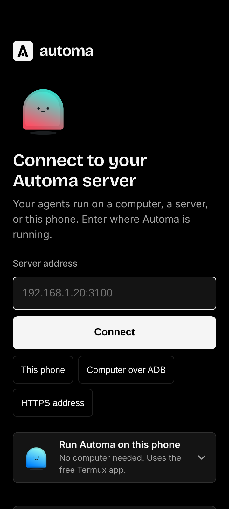
  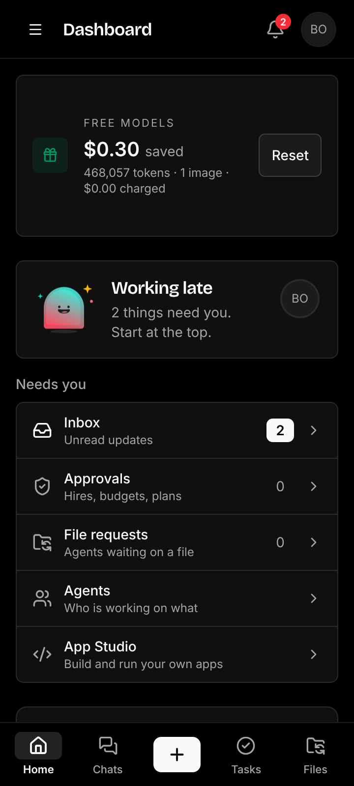
  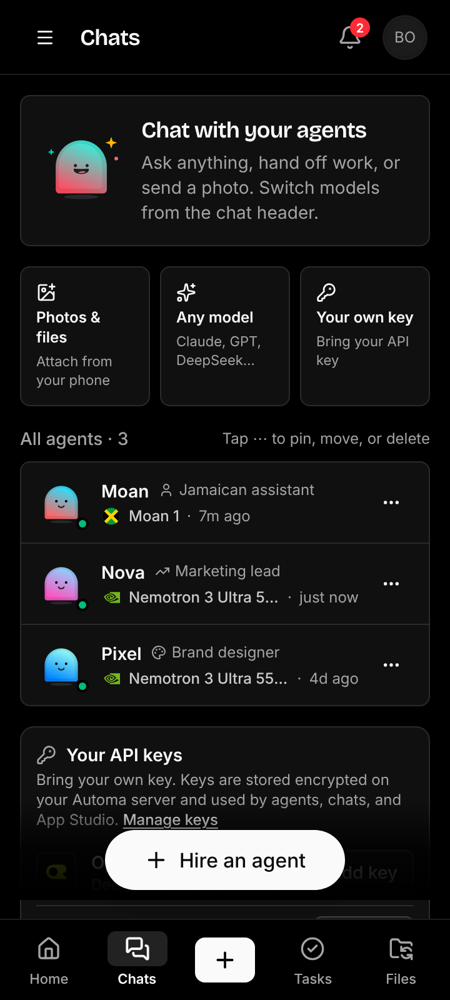

<em>Connect to a server (or run one on the phone) · Home · Chats</em>

> **Download:** the signed APK is in the release zip and in this repository under
> `releases/android/`. **Coming soon on APKPure** — the same signed build will be
> listed there so updates arrive on their own.

---

## Contents

1. [What Automa does, in one minute](#what-automa-does-in-one-minute)
2. [Get started](#get-started)
3. [Chats with your agents](#chats-with-your-agents)
4. [Free models, Moan and the Que engine](#free-models-moan-and-the-que-engine)
5. [Tasks, approvals and the Inbox](#tasks-approvals-and-the-inbox)
6. [Agents and the org chart](#agents-and-the-org-chart)
7. [Projects, goals and routines](#projects-goals-and-routines)
8. [Artifacts and your phone's files](#artifacts-and-your-phones-files)
9. [Skills and connectors](#skills-and-connectors)
10. [App Studio: build apps from your phone](#app-studio-build-apps-from-your-phone)
11. [Terminals and App Inspector](#terminals-and-app-inspector)
12. [Costs, budgets and usage limits](#costs-budgets-and-usage-limits)
13. [Search, audit and the timeline](#search-audit-and-the-timeline)
14. [Settings, your profile and the tour](#settings-your-profile-and-the-tour)
15. [Running Automa on the phone (Termux)](#running-automa-on-the-phone-termux)
16. [Security and privacy](#security-and-privacy)
17. [Download and install](#download-and-install)
18. [What's new](#whats-new)
19. [Questions people ask](#questions-people-ask)
20. [Credits](#credits)

---

## What Automa does, in one minute

- **Hire AI agents** with a role, a title, a manager and a model. A whole team in
  one tap from the teams catalog, or one agent at a time.
- **Chat with them** like teammates: replies stream in, their thinking shows in a
  panel, they search the web and cite sources, read your attachments, draw
  pictures, and make real Excel, PowerPoint and Word files.
- **Give them tasks.** Every task has one owner, a plan, a history and a cost.
  Agents ask you questions right in the task when they need a decision.
- **Approve what matters.** Hires, budgets, plans and anything an agent gets
  stuck on wait for your yes in the Inbox. Agents never spend or hire on their own.
- **Build apps on the phone.** App Studio writes, runs, previews and shares apps
  in 69 languages, with an AI pair or an AI team, and undo for every change.
- **Use free models.** Twenty-plus chat models and two image models that need no
  key, including **Moan**, Automa's own Jamaican model that talks Patois and knows
  Jamaica's news, law and government.
- **Bring your own models** too: Claude, GPT, Gemini, DeepSeek, Grok, Kimi,
  Cursor, Codex, Gemini CLI, OpenCode and any OpenAI-compatible endpoint.
- **Run coding terminals** (Claude Code, Codex, Gemini CLI) on the device, and
  **take apps apart** with App Inspector.
- **Count every token.** Costs by agent, by task and by month, hard budget stops,
  and what free work would have cost at paid prices.
- **Keep it yours.** Your organizations, chats and files live on your own server,
  which can be the phone in your hand.

---

## Get started

1. **Install the APK** (see [Download and install](#download-and-install)).
2. **Connect.** The connect screen takes a server address such as
   `http://192.168.1.20:3100`, or you tap **Run Automa on this phone** and the
   app sets up a server inside Termux for you, with a progress bar for each step.
   A computer can also be linked over a USB cable or Wireless debugging.
3. **Create an organization** with a name and a goal.
4. **Hire your first agent.** Pick a name, a role and a model, or tap
   **Skip for now: start on the free models**.
5. **Say what you want done** in Chats. The agent plans, creates tasks and asks
   when it needs you.
6. **Take the tour.** One card per section, with Skip at every step; run it again
   any time from your profile.

  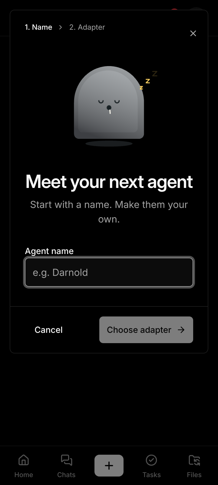
  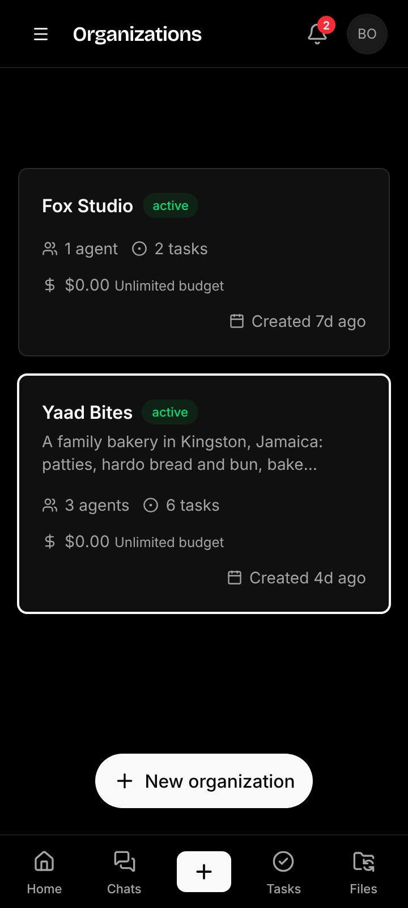
  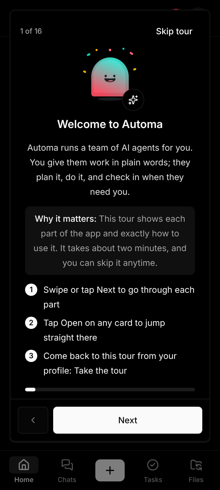

<em>Hiring an agent · More than one organization on a server · The tour</em>

**Getting around:** a bottom tab bar (Home, Chats, +, Tasks, Files) that stays in
thumb reach, a sidebar with every section and the organization switcher, a bell
for the Inbox, and your avatar for the account sheet. Long-press the app icon for
shortcuts: New chat, New task, App Studio, Change server, Files. Every screen is
edge-to-edge, keyboard-aware, and works in portrait and landscape on phones,
tablets, foldables and Chromebooks. Destructive actions come with **Undo**, not
"are you sure?" dialogs.

---

## Chats with your agents

Talk to an agent like a teammate. Replies **stream** token by token; the model's
**thinking** streams into its own panel and folds away when the answer starts.
Tables wider than the screen scroll sideways. Source links show the site's
favicon. When a reply fails, the chat says why in plain words, and you can switch
model and send again.

  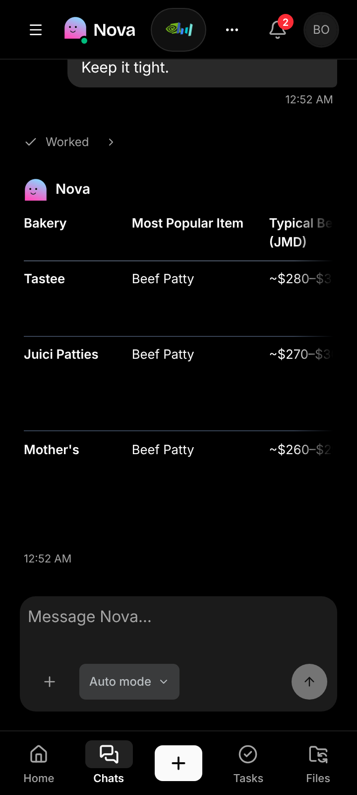
  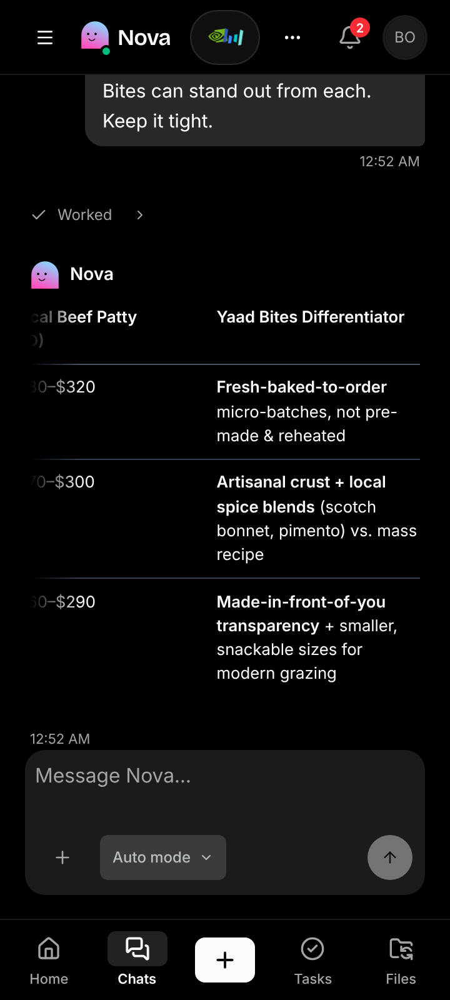
  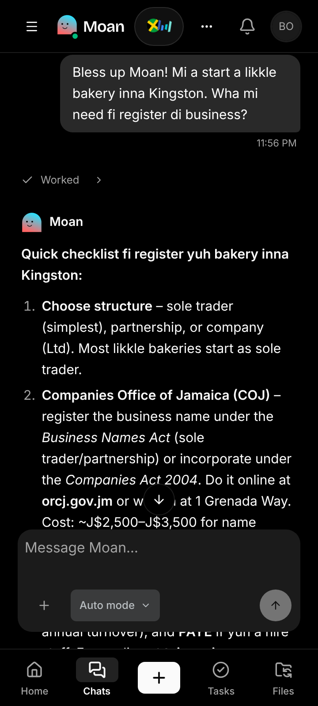

<em>Web search with sources · Wide tables scroll · Moan answers in Patois</em>

**Pictures.** Ask any free chat model for a picture and its paired image model
draws it. Attach a photo and say what to change, and the model redraws it. Tap a
picture to view it full size or **Download** it to the phone; **Draw again** asks
for a fresh take.

  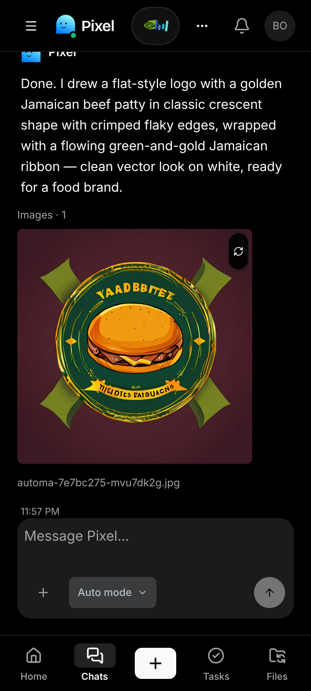
  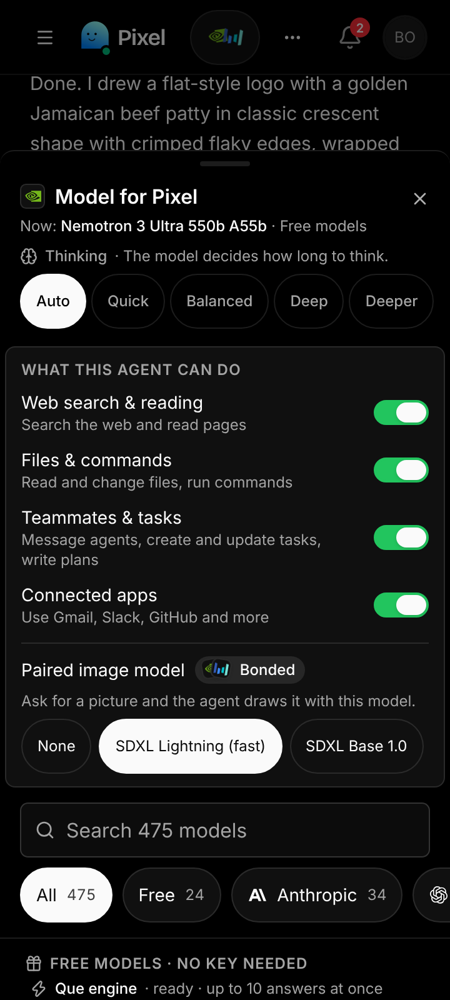
  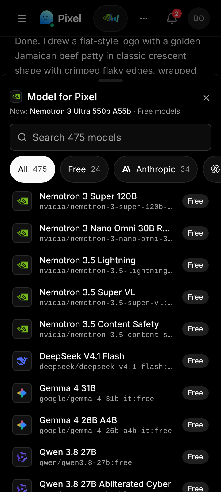

<em>A drawn logo · The model switcher and tool switches · Free models with live status</em>

**The model switcher** (in the chat header) lists every provider with its key
status and the maker's logo, a **Free** filter, **thinking depth** (Auto, Quick,
Balanced, Deep, Deeper, Max), and switches for what a free agent may do: **Web
search & reading, Files & commands, Teammates & tasks, Connected apps**. A
**paired image model** gives a chat model the power to draw; a small "Bonded"
mark shows the two makers' logos together.

**Messages.** Copy, retry, delete and thumbs up/down on the newest reply; press
and hold any other message for the same menu. Attach photos, screenshots, PDFs or
any file with **+**. Unsent drafts survive leaving the chat. ⋯ on a chat pins,
moves or deletes it.

**Slash commands:** `/plan` (plan first, nothing runs until you say so), `/ask`
(answers only, no changes), `/auto`, `/model`, `/think deep`, `/context`,
`/stop`, `/clear`, `/skills`, `/help`, `/new`.

**Notifications.** When an agent finishes a reply, or an App Studio job ends,
while you are outside the app, a notification says so. Tap it to jump straight
to that chat, task or project.

---

## Free models, Moan and the Que engine

No key, no account, no card. Pick a free model in the switcher and the agent runs
on it; your other models stay where they are.

**Chat models:** Moan (Jamaican, on Nemotron 3 Ultra) · Nemotron 3 Ultra 550B ·
Nemotron 3 Super 120B · Nemotron 3 Nano Omni 30B Reasoning · Nemotron 3.5
Lightning · Nemotron 3.5 Super VL · Nemotron 3.5 Content Safety · DeepSeek V4.1
Flash · Gemma 4 31B · Gemma 4 26B A4B · Qwen 3.8 27B · Qwen 3.8 27B Abliterated
Cyber · Inkling · Inkling Small · Flint v1.0 · North Mini Code · Atria Dawn
Preview · Apodex 1.1 Mini · LFM 2.5 2.6B · Xing 4.0 29B A4B · Ternary Bonsai 27B
· Free Router (sends each question to an available free model).

**Image models:** SDXL Lightning (fast, the default pairing) and SDXL Base 1.0.

Every model stays listed and says how it is doing: ready, busy, at today's free
limit (and when it is back), or closed by its provider. Nothing is hidden.

**What a free agent can do:** search the web across many results, read pages,
crawl a site, download files; read, write, edit and search files and run commands
in its workspace; make real **Excel spreadsheets** (with formulas), **PowerPoint
decks** (with charts and pictures) and **Word documents**, and read the
spreadsheets, documents, decks, PDFs and CSVs you attach; draw with its paired
image model; message teammates, hand off work, create and update tasks; and
request the connected apps it needs. It knows its role, its teammates and your
name, and it keeps going through busy providers and dropped connections without
ever switching models behind your back.

**Moan, the Jamaican model.** Patois first, Standard Jamaican English for formal
documents and code. It carries a Jamaica primer (history, government, courts,
statutes, economy, culture) and a **living knowledge index**: while Moan is in
use, Automa keeps reading Jamaican sources (the Gleaner, the Observer, JIS, the
Office of the Prime Minister, Parliament, the Bank of Jamaica, the Laws of
Jamaica) into a local, searchable index, and every reply gets the passages that
match the question plus the newest news, with source, date and link.

**The Que engine** sits under every free-model call: up to ten calls at once, at
most two at a time on any one model, a pool of app IDs that grows on rate limits,
retries on busy answers, a five-minute answer cache, conversations and batches.
Many questions at once all get answered instead of some failing.

---

## Tasks, approvals and the Inbox

Everything the agents are doing, each one a thread you can read, steer and
approve. A task has **one assignee**, a parent and sub-tasks, blockers, comments
with @mentions, a **plan document**, attachments and work products, labels, a
priority and a status (backlog, to do, in progress, in review, blocked, done).
The task page shows the live run transcript with the agent's thinking and tools,
its cost and its full history. An agent can ask you a question with options right
in the task; pick one and it carries on. When an agent finishes a task it asks
you to **approve the result** from the Inbox: approve to mark the task done, or
send it back with what to change and the agent picks it up again.

  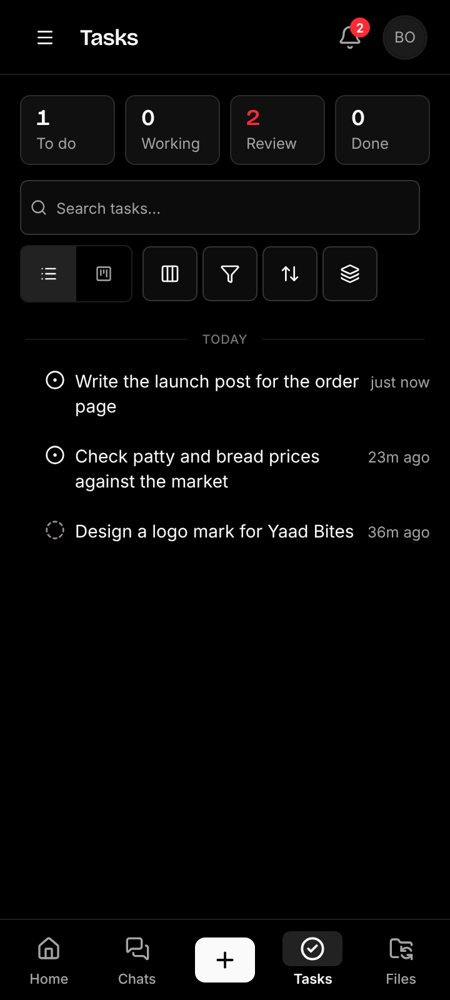
  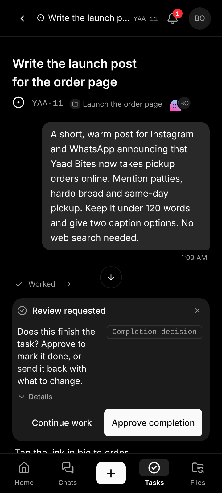
  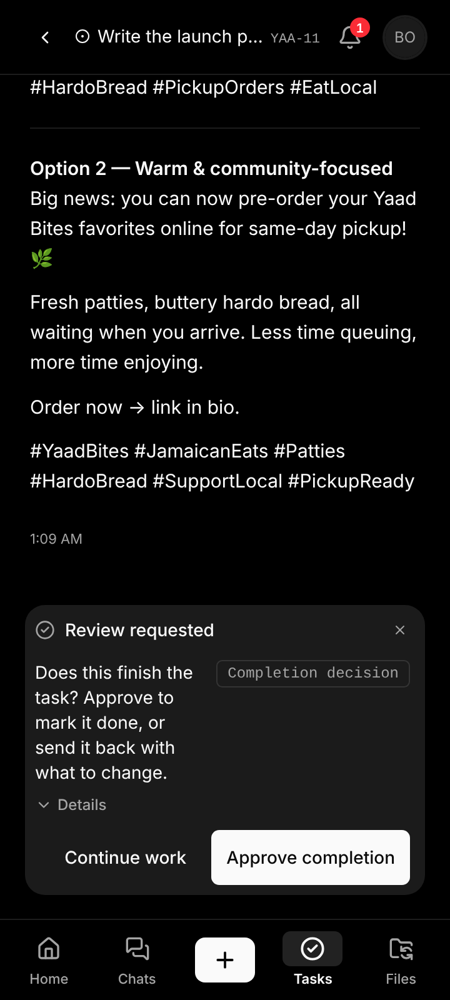

<em>Tasks · A task's thread · The agent's finished work</em>

**Inbox and approvals.** Decisions waiting on you: hires, budgets, plans, join
requests, failed runs and anything an agent got stuck on. Approve, decline or
retry from the phone. The bell shows the count and clears when tapped. The
**Decisions** page keeps the record of every automated and governed decision.

  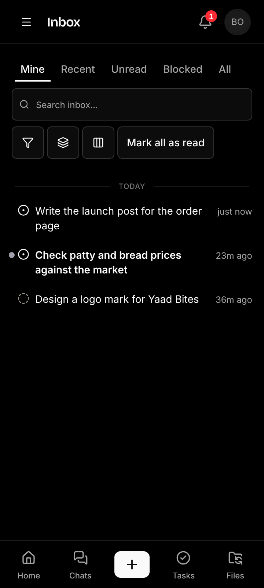
  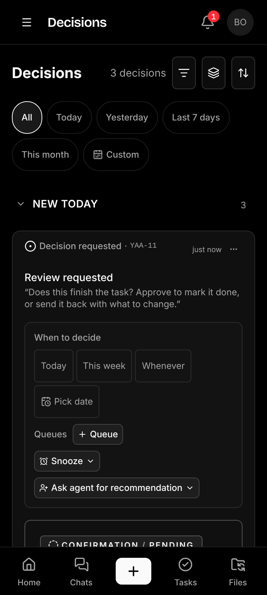
  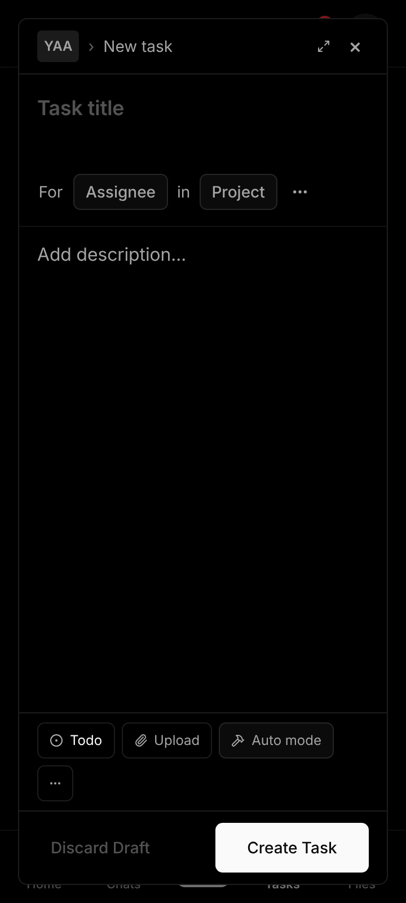

<em>Inbox · Decisions · New task</em>

---

## Agents and the org chart

Each agent has a role and title, an engine and model (with the maker's logo), a
system prompt and instructions, a budget, skills, tools and a manager. The agent
page shows its live runs, logs, progress, instructions and tools. Pause, change or
offboard an agent any time. **New agent** is a short wizard; the **Teams catalog**
installs a whole team (a CEO with executives and engineers) in one go.

  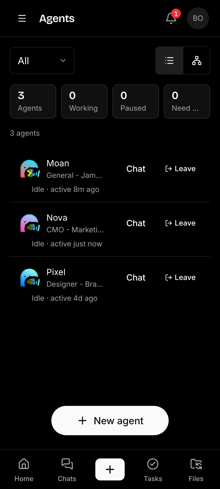
  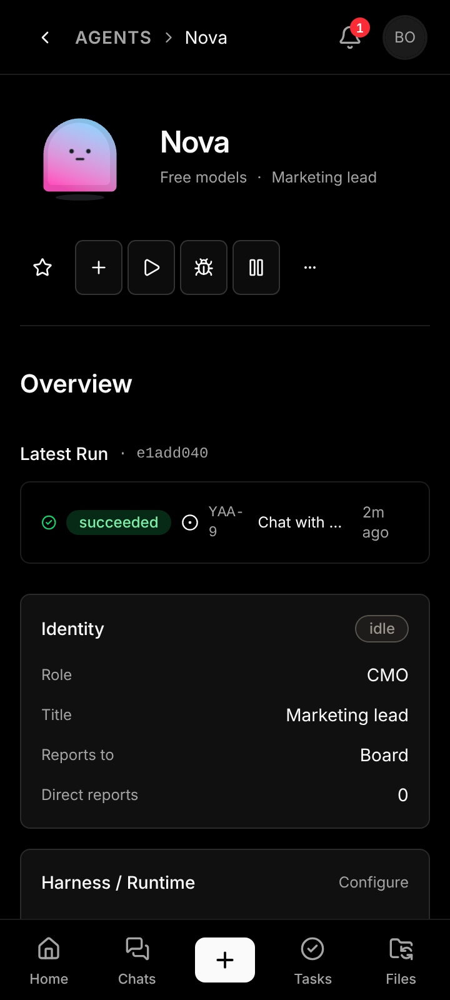
  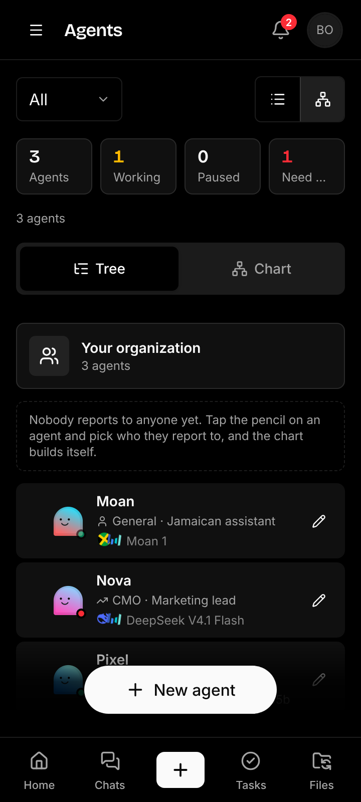

<em>Agents · An agent's page · The org chart with drag-to-connect reporting lines</em>

**Engines:** Claude Code · Anthropic API · Codex · Cursor (local and cloud) ·
Gemini CLI · Grok · Hermes · Kimi · OpenCode · OpenClaw gateway · Pi · **Free
models** · metered API engines · a REST/webhook engine for an agent you host
elsewhere. On a phone, a Claude agent answers through the Anthropic API with
Claude Code's own tools running in Termux.

---

## Projects, goals and routines

**Projects** group tasks under one goal and keep their own workspace. **Goals** are
the top of the task tree, the "why" every task hangs from. **Routines** run work
on a schedule (a daily summary, a weekly review); each run is a task you can
read. Pipelines chain stages of work, cases collect related work into one file,
and workspaces show where an agent's run happens with its live service ports.

  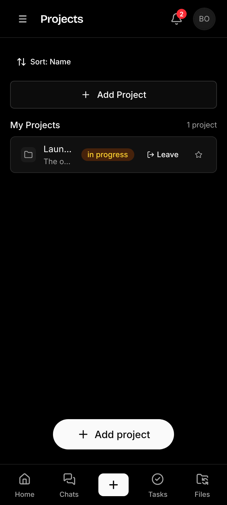
  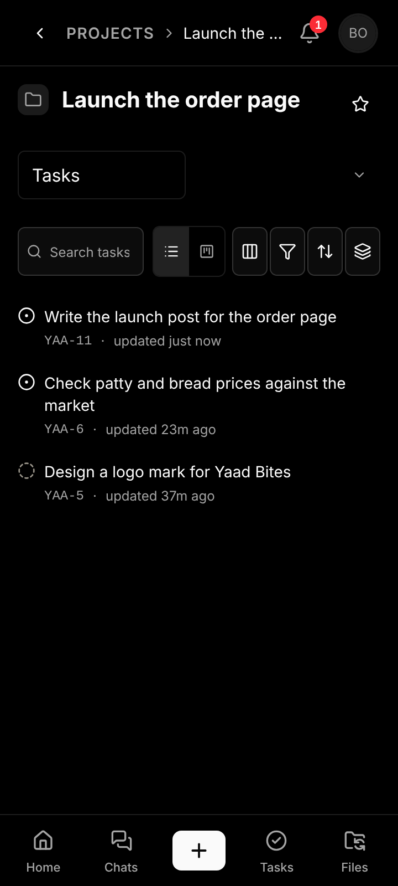
  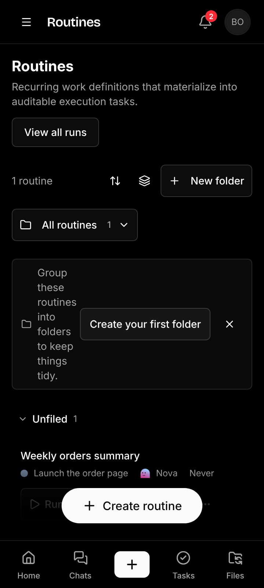

<em>Projects · A project · Routines</em>

---

## Artifacts and your phone's files

**Artifacts** are every file the agents produced, grouped by task, with a viewer
for text, images and code. Downloads go to `Downloads/Automa`.

**Files** shares one folder on the phone with your agents. With **auto-send** on,
a file an agent asks for is sent without asking; otherwise the request waits for
you to pick a file or decline. Agents can send files back. **Share to Automa**
from any app's share sheet and the file waits on the Files page until you
confirm.

  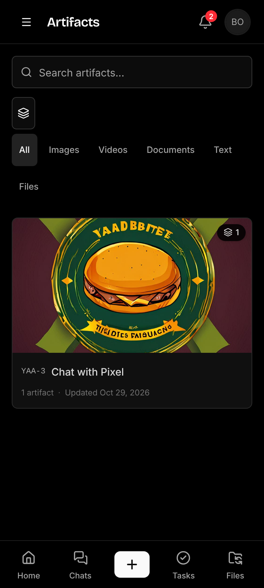
  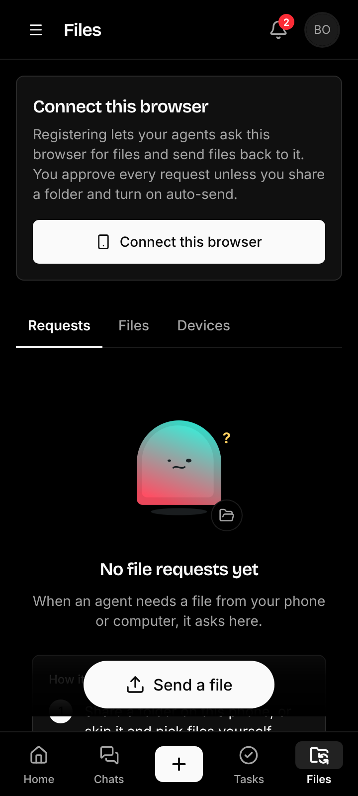
  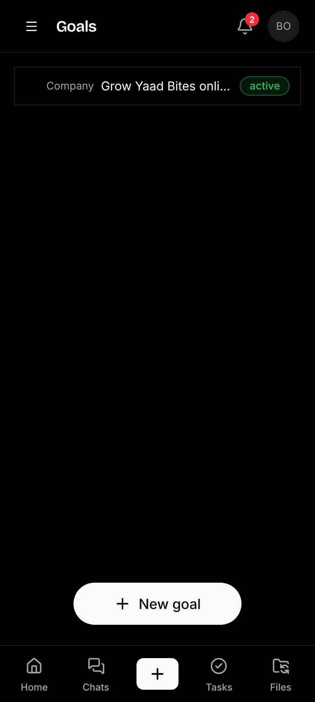

<em>Artifacts · Files · Goals</em>

---

## Skills and connectors

**Skills** are what agents know how to do. Install them from the catalog or build
one in Skill Studio; a new skill is available from the agent's next run.
**Connectors** are the apps agents can reach: GitHub, Slack, Gmail, Notion and
more. Choose which agents get access, which accounts they use and which actions
they may take. Connecting an app stays inside Automa.

  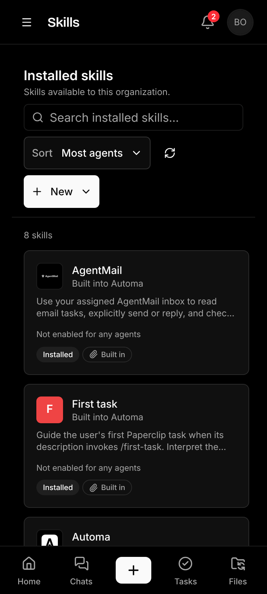
  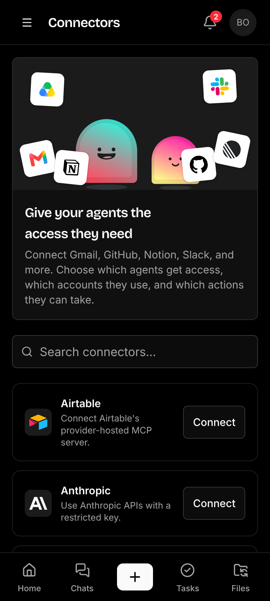

<em>Skills · Connectors</em>

---

## App Studio: build apps from your phone

Build, run and share apps with an AI pair, or a whole AI team, that writes the
code and fixes what breaks. No key needed: the free models work in the AI panel
and for the editor's code suggestions.

- **69 languages in 11 groups**, with quick starts for a website, Python, a
  full-stack app, React, Flask, Go, Rust, a mobile app and TypeScript.
- **Describe your app** in plain words and the assistant builds it from the first
  message. **Clone from GitHub** by pasting a link.
- On a phone each part is a tab: **Files, Code, Console, Preview, AI, Stats,
  Team**. The editor saves on its own and suggests code as you type.
- **Preview** runs the app inside Automa, sandboxed. One tap opens a **public
  link** anyone can open. Missing toolchains install on the device with progress.

  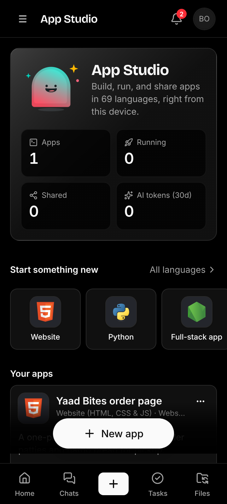
  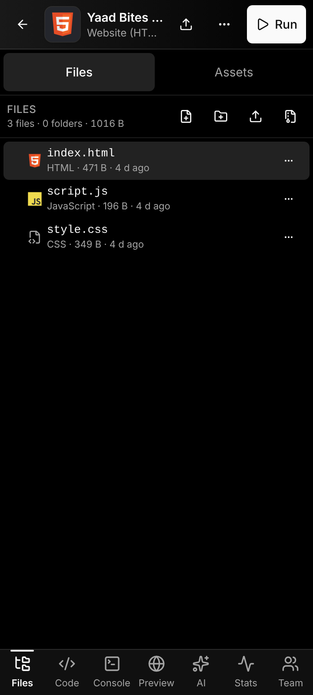
  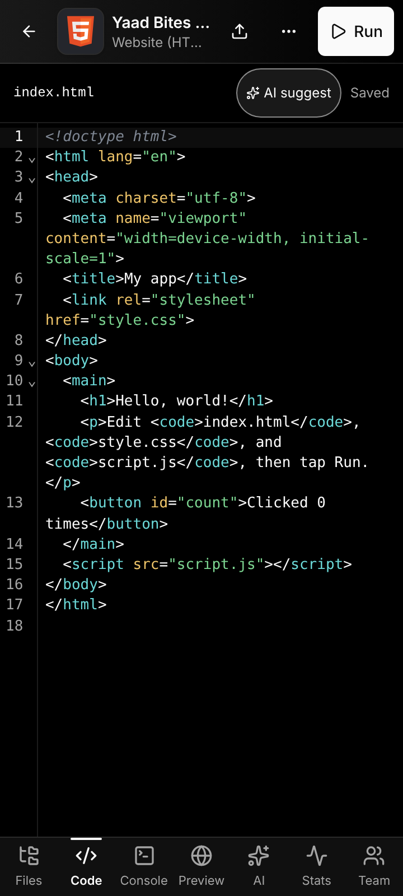

<em>App Studio · Project files · The editor with AI suggestions</em>

**The AI assistant** reads and searches the files, writes and edits code, runs
commands and tests, starts and stops the app, reads the console, searches the
web, and keeps going until the job is done. It **sees the page like you do**: it
opens the running page at phone or desktop size, reads what is on screen, the
console errors and the layout trouble, fixes what it found and looks again. The
preview reloads by itself when files change.

**AI teams.** Pick teammates in the model sheet and the lead model hands them
work: several teammates at once, each with a role and the files it owns, talking
to each other while they work. The **Stats** tab shows a running clock, steps,
files changed and every model at work with live tokens, then the totals and what
the free work would have cost.

  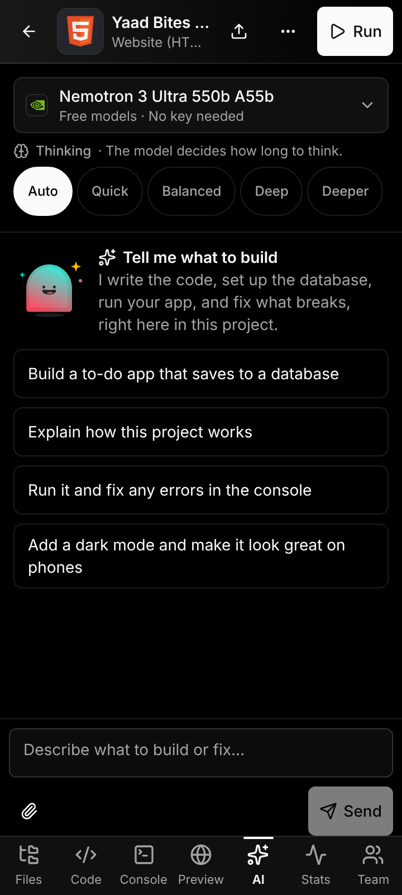
  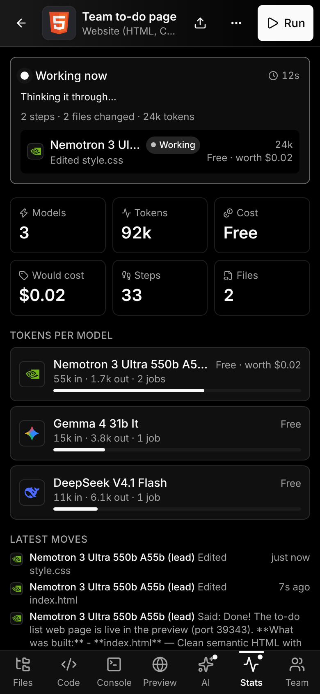
  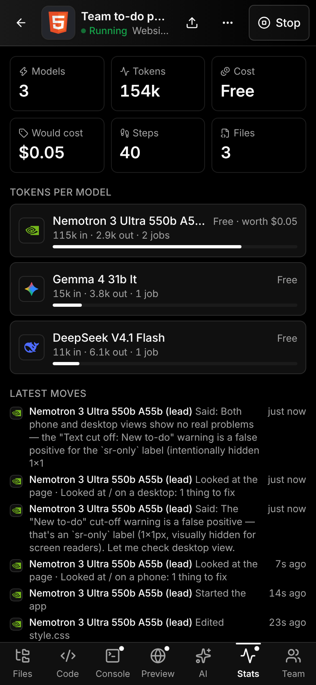

<em>The AI panel · Stats while a team works · Totals and what it would have cost</em>

**Undo and safety.** Undo any change the assistant made, step by step.
Checkpoints are saved before every AI message. Stop is instant. Nothing is ever
written outside the project folder.

**Working with friends.** Invite people with a join code or link (for an hour, a
day, a week, a month or no limit). Guests see your code as you type, chat, send
files and suggest changes you review as a diff; they can't save files or reach
the rest of Automa.

  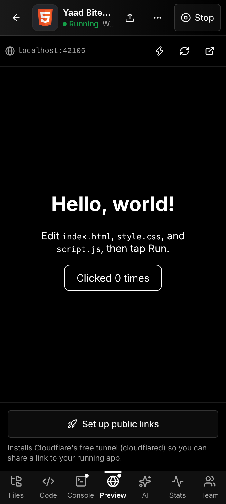
  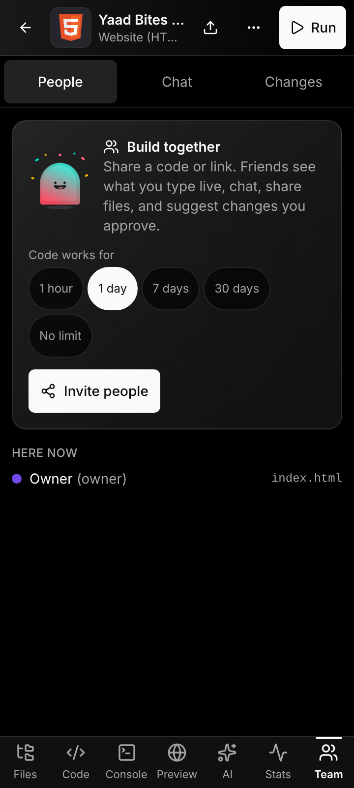

<em>Preview · Build together</em>

---

## Terminals and App Inspector

**Terminals** give you a real coding terminal on the device: Claude Code, Codex,
Gemini CLI, OpenCode and others in their full terminal UI, on a Debian layer the
page sets up for you. Wire a terminal to an agent so it works with that agent's
key, pick a model per tool, or open the **free models chat** with nothing to
install.

**App Inspector** takes an app on your phone (or any APK) apart: it decodes the
manifest, resources and code, shows the code as Java, lets you search, edit and
ask Claude to explain any file, and rebuilds a signed APK to your Downloads. For
apps you made or are allowed to analyze.

  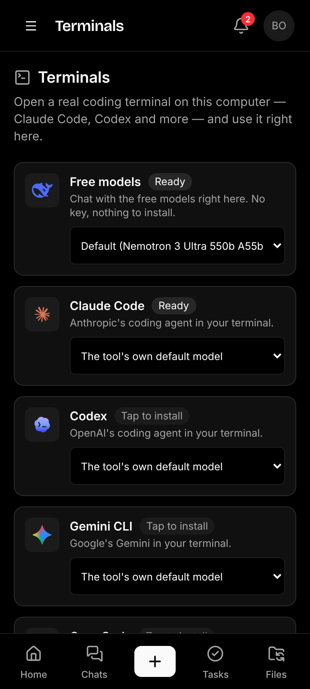
  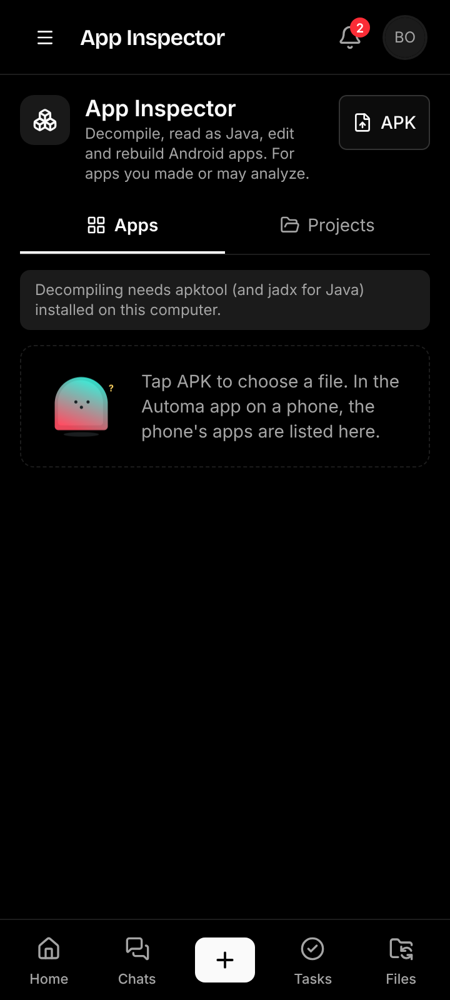

<em>Terminals · App Inspector</em>

---

## Costs, budgets and usage limits

Every token is counted: agent runs, chats, App Studio replies and code suggestions
land on Costs **by agent, by task and by month**. The organization and each agent
have a **budget**, and a hard stop pauses spending at the limit. The **usage
limits** card shows how much of the free models' monthly allowance is used and
when it renews, each free model's daily limit with a countdown, and Claude's
session and weekly limits when Claude Code is signed in. The **free models card**
on Home and Costs shows what the free work would have cost at paid prices.

  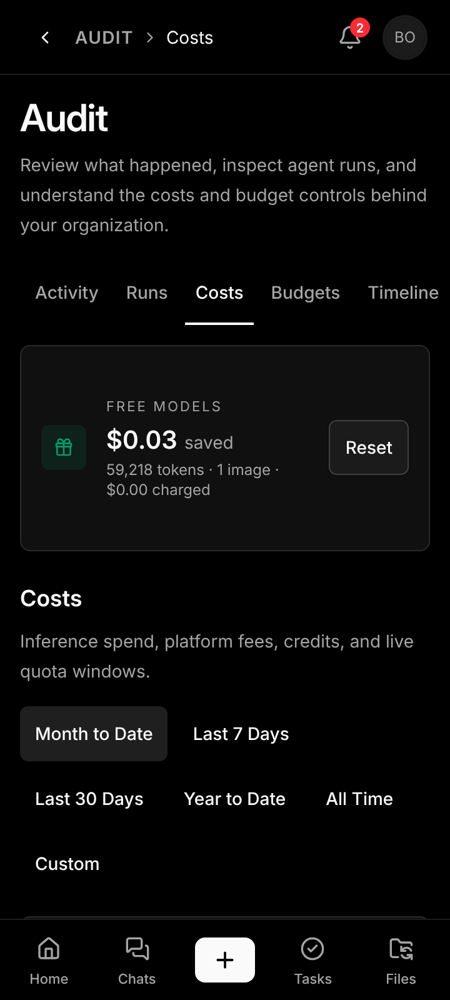
  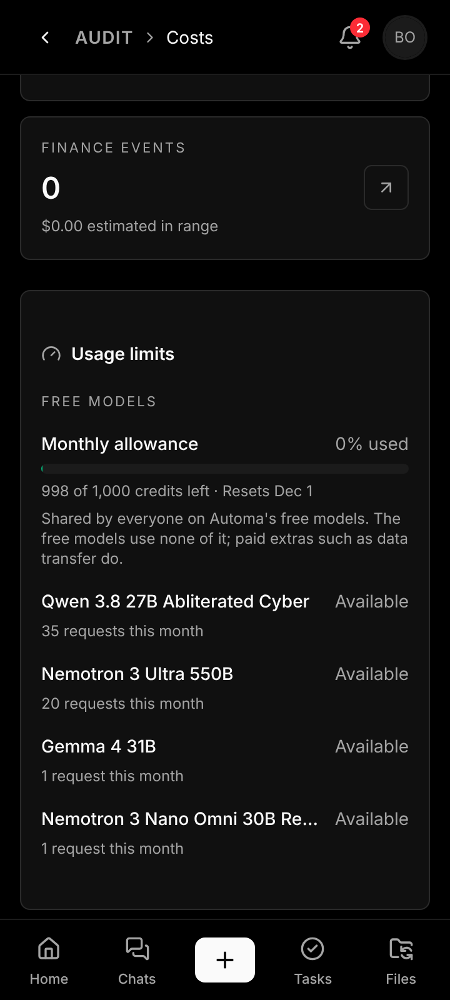

<em>Costs · Usage limits and free-model savings</em>

---

## Search, audit and the timeline

**Search** finds tasks, comments, plan documents, artifacts, agents and projects
in one place. **Audit** holds the log of everything that happened, who did it and
when, with the runs, costs and budgets behind it. The **Work Timeline** shows every
agent's runs side by side.

  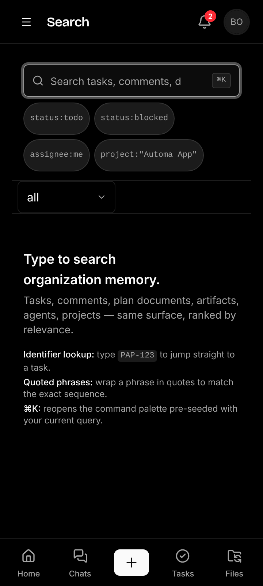
  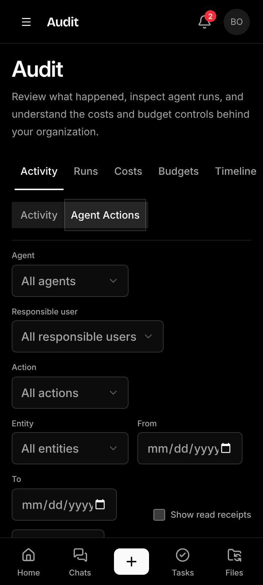
  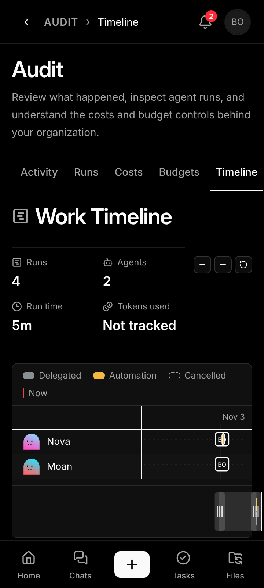

<em>Search · Audit · Timeline</em>

---

## Settings, your profile and the tour

**Organization settings:** general (name, goal, logo, budget), members and
access (invites, roles, join requests), **API keys** (one place for the keys
agents, chats and App Studio run on, with a monthly spending limit), secrets,
adapters, environments, plugins and **Experimental** switches. **Instance
settings** cover the whole server. The **account sheet** shows your profile, your
API balance, the tour, the dark theme and sign-out, and **About Automa** keeps
the full version history.

  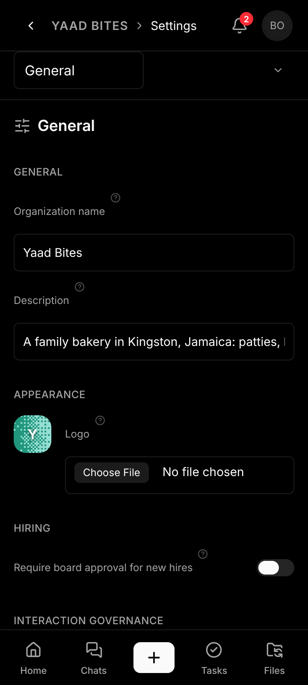
  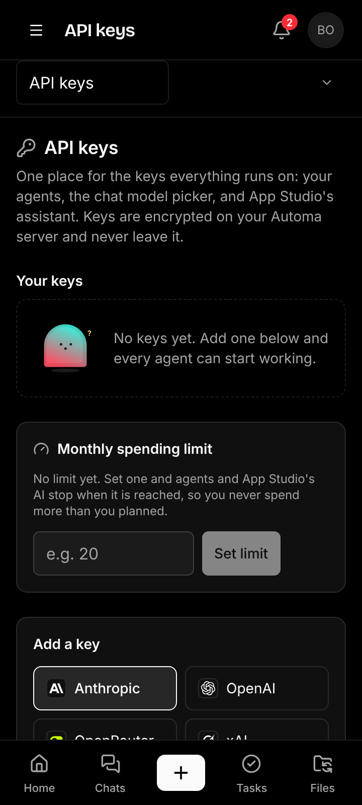
  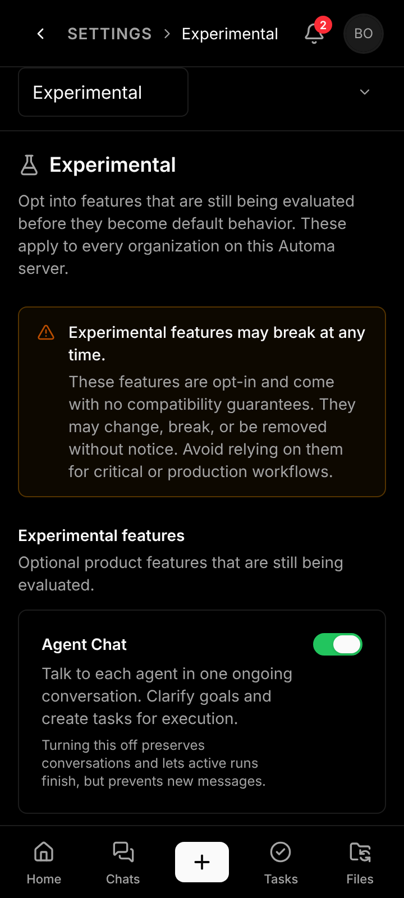

<em>Settings · API keys · Experimental</em>

  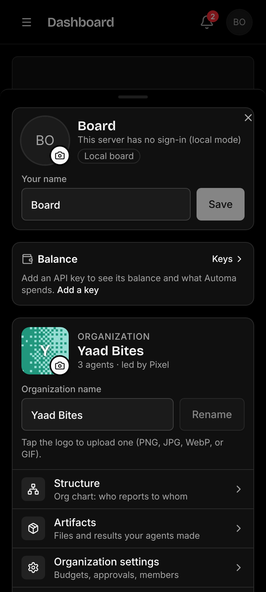
  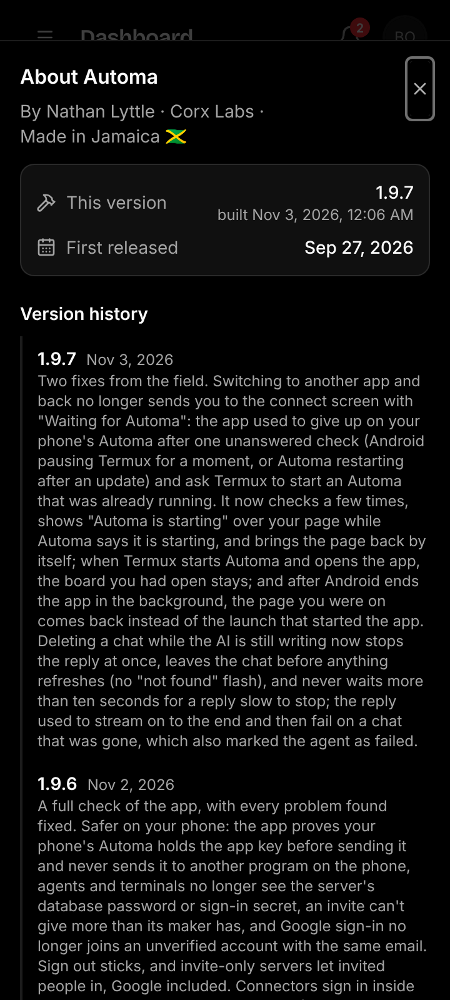

<em>Your profile and organization · About Automa</em>

---

## Running Automa on the phone (Termux)

No computer needed. Install **Termux** from F-Droid, tap **Run Automa on this
phone** in the app, and paste the command Termux is given. The installer sets up
Node.js and PostgreSQL, the server and an `automa` command, then starts Automa on
`127.0.0.1:3100`, locked to the app. The first install downloads a few hundred
packages (10 to 45 minutes); updates are much faster. The connect screen shows
each step with a progress bar and opens the board when the server answers.

| Command | What it does |
|---|---|
| `automa run` | Run in the foreground, restarting the server if it stops |
| `automa start` / `automa stop` / `automa status` | Run in the background, stop it, check it |
| `automa update` | Update the server (it backs up the database first) |
| `automa backup` / `automa restore` | Save a database backup now / put one back |
| `automa link` | Hand the app key to the Automa app again |
| `automa adb link` | Let agents drive the phone over adb (tap, type, screenshot) |

The app starts Automa for you when it isn't running, waits for it with a progress
screen, and shows **Automa is starting** over your page while the server comes up
after an update. Backups are made every hour while Automa runs and before every
update, and a restore never loses the database. Set Termux's battery use to
**Unrestricted**; with Termux:Boot, Automa starts when the phone boots.

---

## Security and privacy

- **Your data stays with you.** Organizations, tasks, chats and files live on your
  own Automa server. The app talks to the server you connect it to, and to Google
  only for sign-in and push notifications when those are set up. Free-model
  requests go from your server to the free AI service Automa uses.
- **Locked to the app.** On a phone, Automa answers only the Automa app, with a
  key the installer makes; the app proves the server holds that key before ever
  sending it, and never sends it to another program on the phone.
- **Agents see only what they should.** Agents and terminals never see the
  server's database password or sign-in secret. Every organization's data is kept
  separate. Keys saved in App Studio are encrypted on your server.
- **Sandboxed previews.** App Studio previews can't act as you or reach the rest
  of Automa. Free agents' web tools never reach private or local addresses.
- **Governed by you.** Hires, budgets and plans wait for your approval; budgets
  stop spending. Invites can't give more than the person who made them has.
- **Privacy policy.** What leaves the phone and what never does, in plain words:
  [PRIVACY.md](PRIVACY.md) (hostable page: `privacy.html`).
- The full threat model is in `doc/AUTOMA-SECURITY.md`.

---

## Download and install

**You need:** Android 8.0 or newer, about 100 MB of storage, and internet for the
AI features.

1. Get the APK from the release zip, or from `releases/android/Automa-1.9.8.apk`
   in this repository.
2. Copy it to the phone and open it. If Android asks, allow **Install unknown
   apps** for the app you opened it with.
3. Tap **Install** (or **Update**). Every release from 1.8.2 on is signed with the
   same key, so a new version installs over the old one and keeps your sign-in,
   settings and data.
4. If your server runs on the phone, run `automa update` in Termux after
   updating the app so the server matches it.

**Coming soon on APKPure.** Automa will be listed on APKPure with the same signed
build, so updates can arrive on their own. Until then the release zip is the
download. There is no Automa cloud account to create, ever.

---

## What's new

**1.9.8** (8 November 2026) — Fixes under the hood. Automa on the phone starts
even when an old queued run is poisoned: the run is cancelled and the others
start, where the whole server used to fail to start. Cancelling a queued run no
longer stalls the scheduler for 30 seconds. Web search falls back to Bing when
DuckDuckGo refuses with a bot check or an error, and a failed search names what
each source answered. Free-model agents hand a task back for your review after
answering, and drop a tool that fails three times in a row instead of looping
to the turn limit. The privacy policy is rewritten for the APKPure build.

**1.9.7** (3 November 2026) — Coming back to the app stays on your page: your
phone's Automa is checked a few times before the connect screen, "Automa is
starting" shows over the page while it starts, a connect request from Termux
keeps the open board, and the page you were on comes back after Android ended
the app in the background. Deleting a chat while the AI is replying stops the
reply at once, leaves the chat before refreshing and never waits more than ten
seconds.

**1.9.6** — A full check of the app with every problem found fixed: the app
proves your phone's Automa holds its key before sending it, agents and terminals
no longer see server secrets, sign-out sticks, connectors sign in inside the app,
keys added while hiring become your default, agent budgets can be set and are
enforced, removing an agent deletes its chats, one Automa per phone, Terminals
show Claude Code and Codex as installed on phones.

**1.9.5** — Notifications when an AI reply or App Studio job finishes while you
are away, a live Stats tab in App Studio, what free work would have cost, and
agents that look at the page like you do.

The full history, release by release, is in **About Automa** inside the app and in
`AUTOMA-README.md`.

---

## Questions people ask

**Do I need an API key?** No. Pick a free model and start. Add keys later in
Settings → API keys if you want Claude, GPT, Gemini or another paid model.

**Do I need a computer?** No. Tap **Run Automa on this phone** and the server runs
inside Termux on the phone. A computer, a VM or a cloud machine works too.

**Is there an account?** Only on your own server, and only when you turn sign-in
on. There is no Automa cloud account.

**What happens offline?** With the server on the phone, Automa itself keeps
working; the AI features need internet.

**Can other people use my organization?** Yes. Invite members with roles; invites
can't give more than you have. App Studio projects can be shared with friends by
code or link.

**Where do downloads go?** `Downloads/Automa` on the phone.

---

## Credits

Automa is made in Jamaica by **Nathan Lyttle (Corx Labs)**. It builds on an
MIT-licensed open-source control plane for AI agents; see `LICENSE`.
